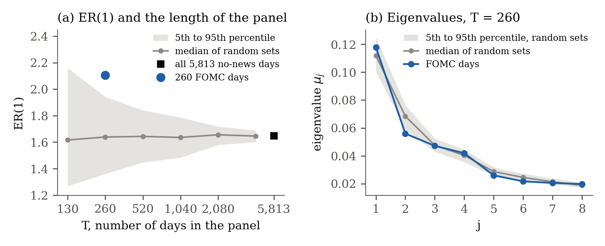
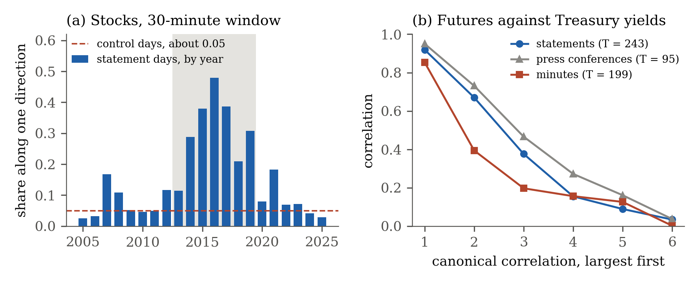

# Do FOMC statements change the factor structure of returns?

M.S. thesis project, Arizona State University (in progress).

When the Federal Reserve releases a policy statement, one piece of news reaches every investor at the same moment. This project asks what that does to the way asset prices move together. There are two possibilities. A statement can add a new common factor, one that is not there on other days. Or it can leave the factors as they are and only make them move more. The answer says whether monetary news is a separate source of common risk, or whether it works through exposures that are always there.

The answer is a count: the number of common factors on statement days against other days. Counting factors is hard when a panel is small, so each estimator is first checked by simulation at the sample sizes used here.

## What is in the data

| Panel | Series | Events | Source |
|---|---|---|---|
| Daily stock portfolios | 379 portfolios | 260 scheduled FOMC days and 5,813 days with no Fed or macro news, 1994 to 2026 | Kenneth French data library |
| 30-minute windows, stocks | large U.S. stocks and ETFs | statement days and matched control days, 2005 to 2025 | TAQ (WRDS) |
| 30-minute windows, rates | interest-rate futures and Treasury yields | 243 statements, 199 minutes releases | U.S. Monetary Policy Event-Study Database |
| Firms | about 400 stocks a year with firm traits | 8 statements a year | CRSP and Compustat (WRDS) |

## First results

These are preliminary. The paper is being written.

1. **Daily returns.** There is one common factor on FOMC days and one on other days, with the same loadings. The first factor stands further above the second on FOMC days: the ratio of the first two eigenvalues is 2.11 against 1.65. Random sets of 260 no-news days reach the FOMC value in 6 of 200 draws.
2. **The 30 minutes around a statement.** In 2013 to 2019 stocks have one common factor beyond the market on statement days and none on control days. It is an interest-rate factor: it moves with the change in yields, and it is gone once yields are taken out. In the other years there is no such factor.
3. **Rates.** Futures and Treasury yields share three directions of movement on statement days. On the days when the minutes come out, two can be seen. The first three canonical correlations are 0.92, 0.67 and 0.38 on statement days and 0.85, 0.39 and 0.20 on minutes days. A permutation test rejects equality for each of the three.
4. **Firms.** The part of a stock's reaction that is tied to firm traits is stronger on statement days than on control days.

One result did not survive its own check. Factor counts inside a single small rate panel sat at the largest value the criterion can reach, and they rose with the number of series. A simulation showed why: with errors that are correlated across neighbouring contracts the criterion always goes to its upper bound. Those counts are not reported. The two-market design above replaced them.





## Methods

| Question | Estimator | File |
|---|---|---|
| How many factors, large panel | eigenvalue ratio and growth ratio, Ahn and Horenstein (2013) | `code/factor_count_v2.py` |
| How many factors, small panel | GMM count with random splits, Ahn and Perez (2010) | `code/ap_tools_v2.py` |
| How many factors are shared with observed variables | canonical correlation approach, Ahn, Dieckmann and Perez (2018) | `code/adp_tools.py` |
| Effects tied to firm traits, few time periods | Ahn, Lee and Schmidt (2013); Bai (2009) | `code/panel_tools.py`, `code/panel_tools_v2.py` |
| Does each estimator work at these sample sizes | Monte Carlo simulation | `code/adp_simulation.py`, `code/panel_sim.py`, `code/review_checks.py` |
| Statement days against control days | permutation tests | `code/panel_perm.py`, `code/review_checks.py` |

Each tool file says which page of the paper each step comes from.

## Extension: look-ahead bias when a language model reads old statements

A language model that is tested on old Fed statements may remember what happened next. Then a backtest looks better than live use would. The extension follows the Entity Neutering method of Engelberg, Manela, Mullins and Vulicevic. A statement is masked and paraphrased until the model can no longer tell which meeting it comes from. The model then scores the raw and the neutered text, and the gap between the two results bounds the leak. Statements released after the model's knowledge cutoff are the control group.

- `code/fomc_statements_pull.py` downloads the statements from the Federal Reserve site.
- `code/neuter_fomc.py` runs the masking rounds and the scoring. It has a dry run that prints the cost before any call is made, and a spending limit.
- `code/neuter_fomc_test.py` compares raw and neutered scores with a paired bootstrap.

This part is being built. No full run is reported yet.

## How to run

```
pip install -r requirements.txt
bash code/download_public_data.sh        # French portfolios and Fed pages
python3 code/day_types.py                # FOMC days, macro release days, no-news days
python3 code/adp_simulation.py           # one of the simulation checks
python3 code/neuter_fomc.py --dry-run    # cost of the language-model run, no key needed
```

The WRDS scripts (`crsp_pull.py`, `taq_fomc_pull.py`, `compustat_pull.py` and others) need a WRDS account. Set the user name in the environment variable `WRDS_USER`. Each script has a `--probe` option that checks tables and columns before it pulls anything.

## Data

Public data are downloaded by the scripts and are not stored in this repository. CRSP, TAQ and Compustat data are licensed and are never committed. Only the list of FOMC meeting days and the list of macro release days are included.

## Status

The analysis scripts for each section of the paper and the paper itself will be added when the paper is finished.

## References

- Ahn, S. C. and A. R. Horenstein (2013). Eigenvalue ratio test for the number of factors. Econometrica 81(3), 1203-1227.
- Ahn, S. C. and M. F. Perez (2010). GMM estimation of the number of latent factors. Journal of Empirical Finance 17(4), 783-802.
- Ahn, S. C., S. Dieckmann and M. F. Perez (2018). Is there a missing factor? A canonical correlation approach to factor models. Review of Financial Economics 36(4), 321-347.
- Ahn, S. C., Y. H. Lee and P. Schmidt (2013). Panel data models with multiple time-varying individual effects. Journal of Econometrics 174, 1-14.
- Bai, J. (2009). Panel data models with interactive fixed effects. Econometrica 77, 1229-1279.
- Engelberg, J., A. Manela, W. Mullins and L. Vulicevic (2026). Entity neutering. Working paper.
- Gurkaynak, R. S., B. Sack and E. T. Swanson (2005). Do actions speak louder than words? International Journal of Central Banking 1(1), 55-93.
